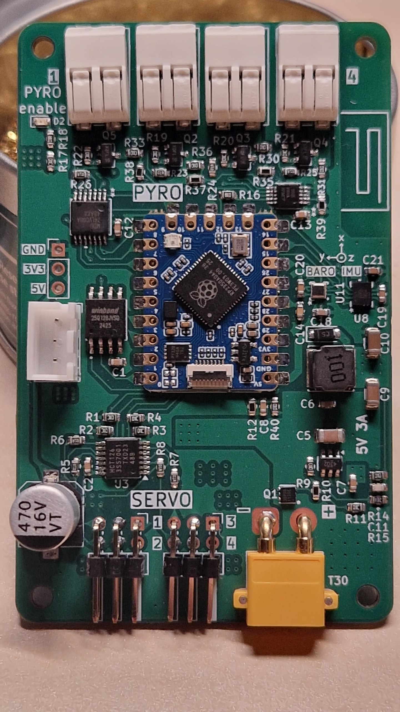
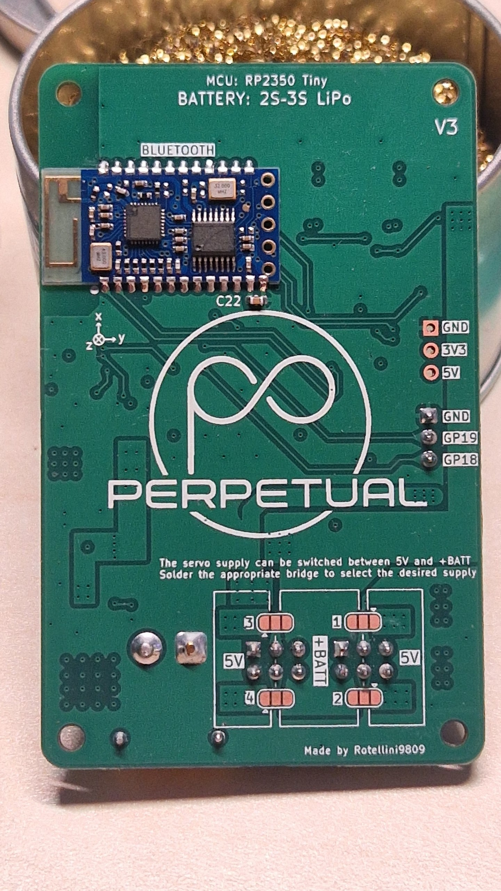
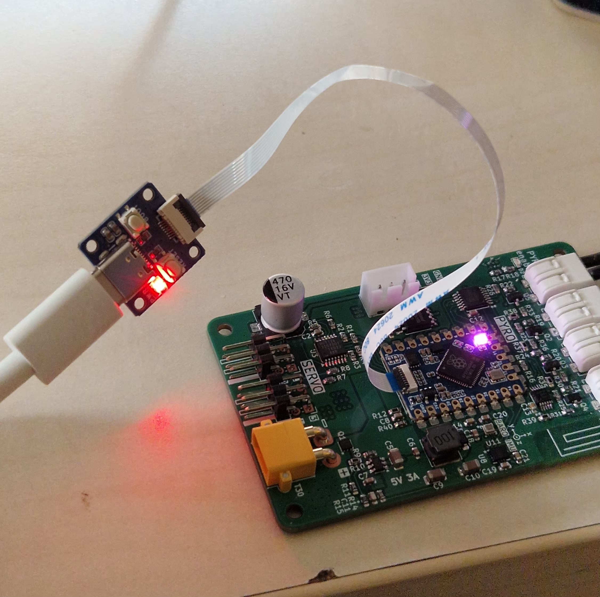

<h1 align="center">Perpetual — Rocket Avionics PCB</h1>

<p align="center">
  A compact RP2350-based flight computer with an IMU, a barometer, 16 MB of flash for flight logs,<br>
  Bluetooth, four pyrotechnic channels and four servo outputs.
</p>

<p align="center">
  <a href="LICENSE"></a>
  
  
  
</p>

---

> **Part of the Perpetual project**, developed for the
> **Sapienza Rocket Team Training Academy**.
>
> | Repository | Contents |
> |---|---|
> | [Perpetual_training_accademy_avionics](https://github.com/Sapienza-Rocket-Team/Perpetual_training_accademy_avionics) | Main project: overview of the whole system, with the two repositories below as submodules |
> | **perpetual_pcb** (this repository) | Hardware: KiCad schematics, PCB layout and fabrication files |
> | [perpetual_code](https://github.com/rotellini9809/perpetual_code) | Firmware and desktop app |

> [!WARNING]
> This board switches **pyrotechnic channels** directly from the battery. Never connect
> igniters or energetics during bench work, and follow your team's and range's safety rules.
> The board has been assembled and bench-tested, but it is **not flight-qualified or certified for
> any use**. Validate any modified version yourself.

## Contents

- [Hardware overview](#hardware-overview)
- [Gallery](#gallery)
- [Connectors](#connectors)
- [Power](#power)
- [Servo power configuration](#servo-power-configuration)
- [Programming](#programming)
- [Repository layout](#repository-layout)
- [Manufacturing](#manufacturing)
- [Development](#development)
- [Author and license](#author-and-license)

## Hardware overview

| Subsystem | Component | Purpose |
| --- | --- | --- |
| Microcontroller | Waveshare RP2350 Tiny | Processing and peripheral control |
| IMU | LSM6DSV32X | 3-axis acceleration (±32 g) and angular rate |
| Barometer | BMP581 | Pressure and temperature, for altitude |
| Storage | W25Q128JV | 16 MB SPI NOR flash for flight logs |
| Wireless | JDY-34 | Bluetooth link to the Perpetual app |
| Pyro channels | 4 × push-in terminals | Igniter outputs, with a shared hardware enable and continuity sensing |
| Servo outputs | 74HCT126 buffer | 4 buffered servo signals, with the supply selectable per channel |
| Power | TPS54302 | 5 V / 3 A buck converter |
| Protection | Schottky diode and TVS | Reverse-polarity and transient protection |

The board also provides battery-voltage monitoring, an RGB status LED, a JST connector for
telemetry or I2C, and USB through the RP2350 Tiny flex cable.

Flight logs are stored in the onboard flash and downloaded with the
[Perpetual app](https://github.com/rotellini9809/perpetual_code) over **USB or Bluetooth**. No
microSD card is needed.

## Gallery

<table>
  <tr>
    <th>Front</th>
    <th>Back</th>
  </tr>
  <tr>
    <td></td>
    <td></td>
  </tr>
</table>

## Connectors

| Ref | Connector | Signals | Notes |
| --- | --- | --- | --- |
| J6 | AMASS XT30 | Battery `+` / GND | Main power input, 2S–3S LiPo |
| J7–J10 | WAGO 2060 push-in, 2-pole | `+BATT` / switched output | Pyro channels 1–4 |
| J4, J5 | 2×3 pin header, 2.54 mm, right-angle | GND, supply, signal | Servos 1–2 and 3–4. Supply chosen per channel, see [below](#servo-power-configuration) |
| J2 | JST-XH, 3-pin | GND, GP19 (RX / SCL), GP18 (TX / SDA) | Telemetry UART or external I2C |
| J3 | 1×3 pin header, 2.54 mm | GND, +3.3 V, +5 V | Auxiliary power for external devices |
| — | RP2350 Tiny FPC | USB | Programming and data, through the flex cable adapter |

The firmware's GPIO assignment for every signal is listed in the firmware's
[hardware reference](https://github.com/rotellini9809/perpetual_code/blob/main/docs/HARDWARE.md).

## Power

The board is designed to run from a **2S or 3S LiPo** battery connected to the XT30 input.
The TPS54302 buck converter generates the 5 V rail (up to 3 A), and the RP2350 Tiny provides
the 3.3 V rail. The battery input is protected against reverse polarity and voltage transients,
and the battery voltage is measured by the MCU.

<!-- TODO: add the exact input voltage range and the maximum pyro channel current. -->

## Servo power configuration

Each of the four servo outputs has its own solder bridge on the back of the PCB. The bridge
connects that servo's supply pin either to the regulated **5 V** rail or to the **+BATT** rail.

<p align="center">
  
</p>

To configure a channel:

1. Disconnect all power sources.
2. Find the bridge for that channel (**1–4**) using the board markings.
3. Solder **only one side**, toward **5V** or **+BATT**.
4. Check the connection and measure the output voltage before plugging in the servo.

> [!CAUTION]
> With **+BATT** the servo receives the full battery voltage, which must be within the servo's
> rated supply range.

## Programming

The board is programmed over USB through the **flex cable and USB-C adapter board** supplied
with the Waveshare RP2350 Tiny. The adapter plugs into the FPC connector of the RP2350 Tiny
module, so the main PCB needs no USB connector of its own.

<p align="center">
  
</p>

**Perpetual firmware.** The flight computer firmware is in
[perpetual_code](https://github.com/rotellini9809/perpetual_code) and is built and uploaded with
PlatformIO. Connect the adapter with the flex cable (contacts on the correct side), then from that
repository run:

```powershell
pio run -t upload
```

If the board is not detected, hold **BOOT** while plugging in the USB cable, then upload again.
See the [firmware quick start](https://github.com/rotellini9809/perpetual_code#quick-start).

**Your own firmware.** For the MCU, Perpetual is a standard RP2350 Tiny, so you can flash it like
any RP2350 board: with the Pico SDK, Arduino-Pico, MicroPython, or by holding **BOOT** while
plugging in USB and copying a `.uf2` file to the `RP2350` drive that appears. For the pin
assignment, see the firmware's
[hardware reference](https://github.com/rotellini9809/perpetual_code/blob/main/docs/HARDWARE.md),
and for the module, the bootloader and the adapter board, see the
[Waveshare RP2350-Tiny wiki](https://www.waveshare.com/wiki/RP2350-Tiny).

## Repository layout

| Path | Contents |
| --- | --- |
| `perpetual_pcb.kicad_pro` | KiCad project: open this file |
| `perpetual_pcb.kicad_sch` | Top-level schematic, with the `power`, `pyro`, `sensors` and memory sub-sheets |
| `perpetual_pcb.kicad_pcb` | PCB layout (4 layers) |
| [`libs/`](libs) | Project symbols, footprints and 3D models |
| [`fabrication_files/`](fabrication_files) | Gerber and drill files |
| [`docs/`](docs) | Images and component datasheets |

## Manufacturing

Ready-to-order **Gerber and drill files** are in [`fabrication_files/`](fabrication_files), and
also zipped as [`fabrication_files.zip`](fabrication_files.zip). The board is a **4-layer** PCB.
Upload the zip to your PCB manufacturer, and check that the files match the revision you intend
to build.

<!-- TODO: board dimensions and mounting holes. -->
<!-- TODO: bill of materials. -->

## Development

Open `perpetual_pcb.kicad_pro` in KiCad 10 to inspect or modify the schematic and the layout.
Before manufacturing or powering a board, review the component ratings, the connections and the
hardware revision.

Contributions and derivatives are welcome within the terms of the license. Please document
meaningful hardware changes and how you validated them.

## Author and license

Designed by **Simone Cargnin** ([@rotellini9809](https://github.com/rotellini9809)) for the
**Sapienza Rocket Team Training Academy**.

Copyright © 2026 Simone Cargnin.

Except where otherwise noted, the original hardware design files and documentation in this
repository are licensed under
[Creative Commons Attribution-NonCommercial-ShareAlike 4.0 International](LICENSE).

When sharing these files or adaptations, give appropriate credit, link to the license and
indicate your changes. Shared adaptations must use CC BY-NC-SA 4.0, a later version, or a
BY-NC-SA Compatible License.

Suggested attribution:
“Based on Perpetual by Simone Cargnin, developed for the Sapienza Rocket Team Training Academy.”
Original project: https://github.com/rotellini9809/perpetual_pcb

Third-party symbols, footprints, models and other assets keep their own licenses.

For commercial permissions, contact rotellini9809@gmail.com.

If you use Perpetual in research, please let me know at the address above. This is a voluntary
request, not a license condition.
