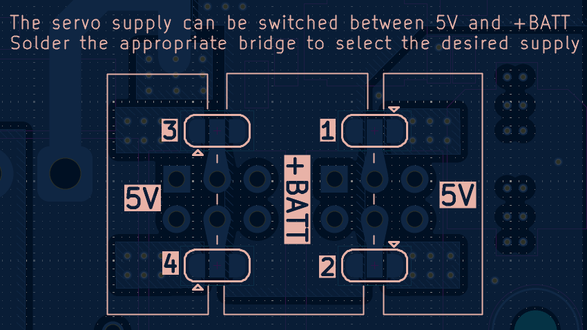

# Perpetual — Rocket Avionics PCB

**Sapienza Rocket Team**

**Hardware Revision:** Rev 4  
**Designed with:** KiCad 10  
**Status:** Assembled and bench-tested

Perpetual is a custom RP2350-based avionics board developed for the **Sapienza Rocket Team**. It combines flight sensing, onboard data logging, and interfaces for recovery and servo actuators in a compact platform.

This repository contains the **KiCad schematics and PCB layout**. Firmware and application software are maintained separately on https://github.com/rotellini9809/perpetual_code.

**Status:** Assembled and bench-tested. This does not imply flight qualification.

## Hardware overview

| Subsystem | Component | Purpose |
| --- | --- | --- |
| Microcontroller | Waveshare RP2350 Tiny | Onboard processing and peripheral control |
| IMU | LSM6DSV32XTR | 3-axis acceleration and angular velocity |
| Barometer | BMP581 | Atmospheric pressure measurement |
| Storage | W25Q128JVSIQ | 16 MB SPI NOR flash for flight logs |
| Servo interface | 74HCT126PW | Buffered control signals for four servo outputs |
| Power regulation | TPS54302 | 5 V buck converter |

The board also provides **four pyrotechnic channels**, battery-voltage monitoring, reverse-polarity protection, and USB access through the RP2350 Tiny flex cable.

Flight logs are stored in the onboard flash and can be retrieved through the associated application over **Bluetooth or serial communication**. No microSD card is required.

## Hardware Gallery

<!-- Add the images under docs/images/ when available. -->

<table>
  <tr>
    <th>Front</th>
    <th>Back</th>
  </tr>
  <tr>
    <td></td>
    <td></td>
  </tr>
</table>

## Servo power configuration

Each of the four servo outputs has an independent solder bridge on the back of the PCB. The bridge selects either the regulated **5 V** rail or the **+BATT** rail for that servo.

  

To configure a channel:

1. Disconnect all power sources.
2. Locate the corresponding bridge (**1–4**) using the board markings.
3. Solder **only one side**, toward **5V** or **+BATT**.
4. Check the connection and output voltage before plugging in the servo.

> **Warning:** Choosing +BATT exposes the servo to the battery voltage, which must be within the servo's rated supply range.

## Development and usage

Open the `.kicad_pro` file in KiCad to inspect or modify the schematic and PCB layout. Before manufacturing or operating a board, review the component ratings, connections, and the specific hardware revision.

This design has been assembled and tested, but any modified version should be validated independently. Pyrotechnic interfaces and attached actuators require appropriate precautions and controlled testing.

Contributions and derivatives are welcome within the terms of the license. Please document meaningful hardware changes and their validation.

## License and attribution

Copyright © 2026 Simone Cargnin.

Except where otherwise noted, the original hardware design files
and documentation in this repository are licensed under
[Creative Commons Attribution-NonCommercial-ShareAlike 4.0
International](LICENSE).

When sharing these files or adaptations, provide appropriate
credit, link to the license, and indicate your modifications.
Shared adaptations must use CC BY-NC-SA 4.0, a later version,
or a BY-NC-SA Compatible License.

Suggested attribution:
“Based on Perpetual by Simone Cargnin, developed for the
Sapienza Rocket Team Training Academy.”
Original project: https://github.com/rotellini9809/perpetual_pcb.git

Third-party symbols, footprints, models and other assets retain
their respective licenses.

For commercial permissions, contact rotellini9809@gmail.com.

If you use Perpetual in research, please notify me at the address
above. This is a voluntary request, not a license condition.